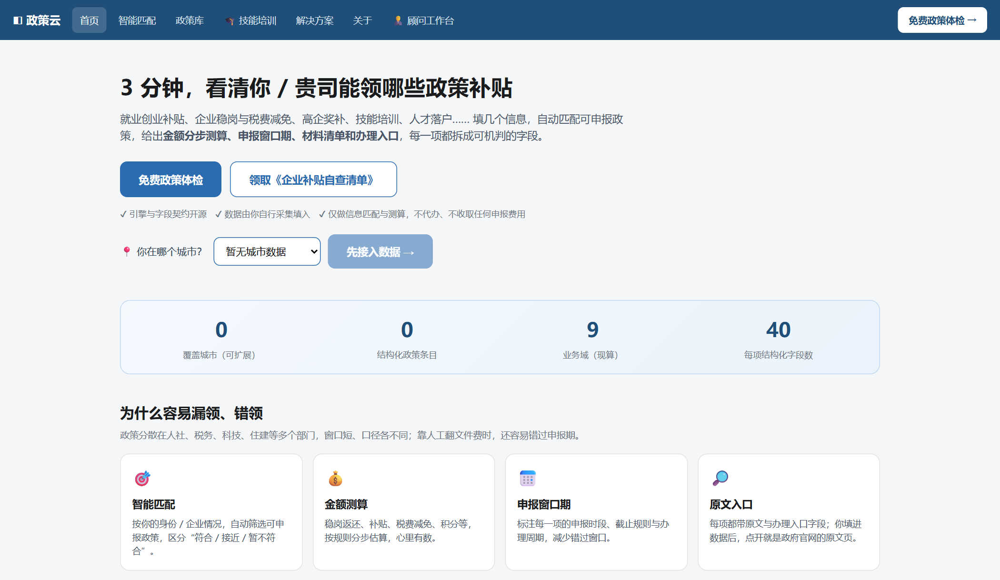
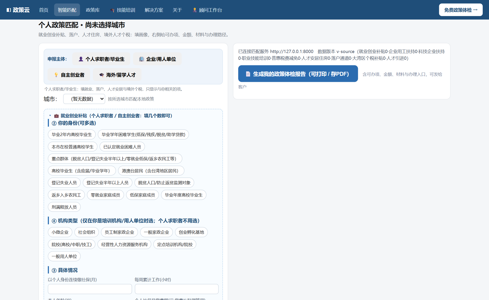

# Policy Hub

**把散在各地政府网站上的补贴政策，整理成一张能直接发给客户的表。**

客户问「我这种情况能领什么补贴」，你不用再一个个官网翻、一页页读原文。
填几个空，清单出来，导出 Excel 就能发给客户 —— 每一条都带原文依据与办理入口。

> 这个仓库开源的是**引擎和数据格式，不含任何政策数据** —— 克隆下来是一个空库，
> 政策条目由你自己采集、按模板填进 `policy_hub/domains/`。
> 完整城市覆盖的政策数据是配套的数据服务，不在本仓。

<sub>English: A rule-based matching engine and field schema for Chinese government
subsidies. City-level, machine-checkable fields, Excel export, MCP server.
No policy data is bundled — you fill `policy_hub/domains/` yourself.</sub>



---

## 先说三件你最关心的事

**1. 能查到什么？**

方向是固定的：引擎按 9 个政策方向建模，字段契约、校验闸门、导出模板都围着这 9 个转。
你采集的数据落在哪个方向，就能查哪个方向：

| 政策方向 | 说明 |
|---|---|
| 就业创业补贴 | 一次性创业补贴、场地租金、创业担保贷款贴息 |
| 企业用工扶持 | 招用重点群体、社保补贴、岗位补贴 |
| 人才引进 | 海外留学人员、高层次人才的生活补贴与安家费 |
| 落户通道 | 应届生、在职、留学、积分、纳税、随迁各类通道 |
| 人才安居住房 | 购房补贴、租房补贴、人才公寓 |
| 科技企业扶持 | 高企认定奖励、研发补助 |
| 职业技能培训 | 培训补贴、考证补贴 |
| 普惠税费减免 | 小微、个体户的税费优惠 |
| 大湾区个税补贴 | 珠三角 9 市，境外高端人才个税差额补贴 |

城市和数据由你填。已有 51 个常见城市码登记在册，填数据时直接建目录即可；
要加别的城市，跑一次 `pipeline/register_city_codes.py`。

> ⚠️ **本仓克隆下来是空库**：9 个方向的定义都在，但一条政策也没有。
> 这是有意为之 —— 政策数据是你的资产，不该由开源仓替你决定。
> 填数据的方式见下面「[接入你自己的数据](#接入你自己的数据)」。


**2. 准不准？**

在**真实数据**上，每条政策的「谁能领、多少钱、什么条件、什么时候截止」都是**逐字比对原文**后填的。

不是关键词搜索，也不是让 AI 读完原文自由发挥 —— 金额和资格必须精确，
「最高 3 万」和「最高 10 万」差的是客户一整笔钱。

仓库里没有数据，所以谈不上准确性 —— 这里保证的是另一件事：**填错会被拦下来**。
字段契约、枚举、链接闸门、申报条件对账，在你出成品之前就红灯拦住。

**3. 能给客户看吗？**

能。导出的 Excel 有 20 列：政策名称、适用对象、补贴标准、申报条件、所需材料、
办理渠道、办理入口、原文链接、有效期…… 客户拿去就能办事，被质疑了直接点链接。

---

## 典型用法：客户坐在你对面

1. **他说情况** —— 35 岁、本科、在本地开公司两年、社保交满 24 个月
2. **你填进去** —— 年龄、学历、城市、身份（个人 / 企业）、社保月数、企业规模
3. **屏幕出三张单**
   - ✅ **能申报**：条件全满足，可以直接办
   - ⚠️ **临界**：差一两个条件，会写明差什么（比如「社保还差 3 个月」）
   - ❌ **不符合**：也会说明卡在哪一条，不是一句「你不符合」就完了
4. **点一下导出** —— Excel 发给他，每行带金额、条件、材料、办理入口、原文链接



原来要靠一个熟手记半年的事，现在当场就能答。

---

## 数据凭什么敢给客户看

这是接入数据后首先要回答的问题，所以单独说清楚。

> 下面讲的是**你接入自己的政策数据后**的处理规范，也是字段契约长成这样的原因。

| 客户会问 | 我们怎么处理 |
|---|---|
| 政策是从哪来的 | 每条都有政府官网原文地址，客户可以自己点开核对 |
| 会不会抄错金额 | 金额、期限、适用主体逐字比对原文，不一致就整条重查 |
| 查不到的地方怎么写 | 字段留空或标「待补采」，**绝不用印象补齐** —— 宁可显示「未知」，不给一个看起来合理但错的数字 |
| 政策过期了怎么办 | 到期、被新文件替代的单独标状态，不混在现行政策里发给客户 |
| 客户其实不符合呢 | 结果分三类，能申报 / 临界（差什么）/ 不符合（卡在哪），不糊弄 |

一句行话总结：**宁可少给一条，不给错的一条。** 客户按错的信息去窗口排队，
浪费的是他的时间，丢的是你的口碑。

---

## 谁在用它

| 你是谁 | 原来怎么做 | 用它之后 |
|---|---|---|
| 政策申报 / 代办服务商 | 客户问能领什么，凭经验答，或者现查官网 | 当场出清单，差哪条说得清楚，客户当场敢签 |
| 财税 / 工商代理 | 政策不是主业，问到了才临时查 | 多一项能收费的增值服务，不用专门招人研究政策 |
| 园区 / 孵化器 | 给入驻企业做政策宣讲，内容年年重做 | 一家一份定制清单，批量导出 |
| 猎头 / HR | 人才引进、落户、购房补贴靠打听 | 直接查到这座城市的具体条件和金额 |
| 自己创业 / 上班的人 | 不知道自己能领钱 | 五分钟查一遍，别把该拿的漏了 |

---

## 仓库里有什么，没有什么

**有的（都能直接跑）：**

- 匹配引擎 —— 规则判定，不调大模型，**不需要 API key**
- 统一数据格式 —— 每条政策 40 个字段，所有城市共用一套
- 数据目录骨架 + 新建城市模板 —— `templates/new_city/`，复制就能填
- 字段契约与校验闸门 —— 字段、枚举、键集同步、链接、申报条件对账
- 前端界面 —— 单文件，客户端 / 顾问后台两种模式
- Excel 导出 —— 20 列成品清单，含材料、办理入口、原文链接
- 采集工具三件套 —— 抓页面、提正文、站内搜索（`policy_hub/collector/tools/`）
- 一键启动 + 服务器部署脚本（nginx / systemd）
- MCP Server —— 让 AI 助手直接调用（5 个工具）
- 51 个常见城市码 · 9 个政策方向 · 40 字段的完整契约

**没有的：**

| 缺什么 | 为什么 |
|---|---|
| 政策数据 | 政策条目是数据资产，也是要持续维护的东西；本仓只给引擎、格式和校验，数据由你自己采集填入 |
| 站点采集配置 | 每座城市从哪个栏目抓、怎么绕验证，是采集里最花时间的部分，逐城不同 |
| 测试套件 | 完整测试里很多断言是「全库 > 700 条」这类全量检查，放进空仓会一片飘红 —— 一堆失败用例比没有测试更误导人 |

> **空库是正常状态，不是装坏了。** 克隆下来直接跑：
> 界面能开、接口能通、匹配返回空结果，`/api/v1/meta` 里 9 个方向的计数都是 0。
> 按下一节填进第一批数据后，这些地方就开始有内容了。

---

## 五分钟跑起来

只要有 Python 3.10+。不用配数据库、不用填 API key、不用改任何配置文件。
跑起来是空库 —— 界面和接口都正常，只是没有政策数据，这是预期状态。

```bash
git clone https://github.com/amazys-lab/policy-hub.git
cd policy-hub

python -m venv .venv
.venv\Scripts\activate          # macOS / Linux 用：source .venv/bin/activate
pip install -r requirements.txt

python run.py
```

浏览器打开 <http://127.0.0.1:8000/> 就是完整界面，接口文档在 <http://127.0.0.1:8000/docs>。

要部署到服务器（nginx 反代 + systemd 开机自启），见 `deploy/` 目录。

---

## 接入你自己的数据

数据放在 `policy_hub/domains/cities/<城市码小写>/<域英文名>/` 下，
一座城市一个目录，一个政策方向一个文件。

**第 0 步：确认这座城的城市码在不在册**

`policy_hub/common/schema.json` 的 `city_code` 里已登记 51 个常见城市（两字母大写，目录用小写）。
在册的直接跳到第 1 步；不在册的先登记，否则界面里静默不出现：

```bash
# 在 pipeline/register_city_codes.py 顶部的 NEW 列表加一行：
#   ("YB", "宜宾市", "宜宾", "四川")   # (城市码, 全名, 前端简称, 省份；YB 不在预置的 51 个里)
python pipeline/register_city_codes.py            # 预演，不落盘
python pipeline/register_city_codes.py --apply    # 写入 5 个注册点
```

**第 1 步：建目录、复制模板**

```bash
# SZ = 深圳；城市码见 policy_hub/common/schema.json
mkdir -p policy_hub/domains/cities/sz/employment_startup
cp policy_hub/templates/new_city/programs.template.json \
   policy_hub/domains/cities/sz/employment_startup/programs.json
```

**第 2 步：照着模板改内容**

模板开头的 `_填写说明` 写清了必填字段和几条硬规矩：

- 每条必须带官方文号 + `*.gov.cn` 原文链接，第三方站点只作线索
- 金额单位是元、写阿拉伯数字
- 达不到 L4（能逐字对回原文）就诚实标 `depth`，并在 `to_collect` 里写明缺什么
- ID 形如 `XX-EMP-001`（`XX` 为城市码），全局唯一，删掉的号不复用
- **`cond.applicant_kinds` 要写全「谁能领」** —— 这一条写错，政策不会报错，只是永远匹配不出来：
  创业补贴如果个人和创业者都能领，必须写 `["person","entrepreneur"]`，只写 `["person"]`
  的话「自主创业者」那张画像永远看不到它

**第 3 步：校验，然后看结果**

```bash
python pipeline/check_data.py               # 字段契约 + 枚举 + ID 唯一性（无参数直接跑）
python -m policy_hub.aggregator.aggregate   # 引擎自检，会打印库里的条数
python run.py                               # 界面里城市下拉就有这座城了（不用改前端）
```

填错的地方闸门会直接指出来 —— 红在哪一条、哪个字段，不用自己猜。

**第 4 步：出成品**

```bash
# B 端（机构看的全量表）：--cities 可指定多城（城市码须在册）
python pipeline/export_excel.py --audience b --cities SZ,NN --title "政策总表" --out out.xlsx

# C 端（个人读者清单）：单城用 --preset city_<城市码小写>，多城用 --preset prd / all
python pipeline/export_excel.py --audience c --preset city_sz --out out_c.xlsx

# 只读对账：列出每份成品期望多少条、哪份缺了（不生成文件，改了数据后跑这个看有没有漏）
python pipeline/release_matrix.py
```

★ C 端不认 `--cities`（它要按城市出单本册子，必须用 `--preset city_<码>`），B 端认。
★ 加过城之后，`--preset all` / `c_all` 会自动带上新城市；`gd` / `prd` 是固定珠三角名册，不会自动加。

细节见 [`policy_hub/domains/README.md`](policy_hub/domains/README.md)。

---

## 给 AI 助手用

仓里带了一个 MCP Server，接上之后可以直接对 AI 说：

> 我在 SZ，30 岁、本科，开公司两年了，能领什么补贴？

（前提是这座城已经填了数据；空库时它会直接告诉你暂时没有可匹配的政策，而不是编一条出来。）

它会自动走完「查字段 → 匹配 → 取详情 → 出清单」，不用你教它怎么查。

```json
{
  "mcpServers": {
    "policy-hub": {
      "command": "python",
      "args": ["-m", "mcp_server.server"],
      "cwd": "<这个仓库的绝对路径>"
    }
  }
}
```

默认本地模式，零配置；设环境变量 `POLICY_HUB_URL` 则改连你部署好的服务端。
细节见 [`mcp_server/README.md`](mcp_server/README.md)。

---

## 免责声明

**请在使用前读完这一节。这个仓库提供的是工具，不是政策本身。**

1. **本仓库不附带任何政策数据。** 数据目录初始为空，所有政策条目均由使用者自行
   采集、填写和维护。仓库作者不提供、不背书，也不对任何第三方填入的数据负责。

2. **匹配结果是规则估算，不是官方结论。** 引擎按结构化字段做条件判定与金额测算，
   不构成任何形式的申报承诺、资格认定或获批保证。真实办理请以当地政府官方发布的
   最新文件及经办窗口审核为准。

3. **本仓库不提供代办服务。** 不代理申报、不收取申报费用、不与任何政府部门存在
   委托或合作关系。任何人以本项目名义收费、承诺结果，均与本项目无关。

4. **数据的准确性由数据使用者负责。** 政策会修订、废止、到期，上线前请自行核对
   原文与时效；因使用本项目（含自行填入的数据）产生的申报失败、错过窗口、
   金额误算等后果，本项目作者不承担责任。

5. **许可证是 AGPL-3.0。** 你可以自由使用、修改、自建服务；若把修改后的版本
   作为网络服务对外提供，需按 AGPL-3.0 公开你的修改。

一句话：**工具开源给你，判断请自己负责。**

---

## 联系

仓库里给的是引擎和一个空的数据目录。要是你想把它做成能交付给客户的东西，
或者需要已经整理好的政策数据，直接找我就行，一般当天回。

- 邮箱：**wx532478@163.com**
- 微信：**`wxppbot`**

加微信请备注「**GitHub + 所在城市**」，否则可能被忽略。

---

## 给开发者：技术怎么设计的

前面几节是给业务看的。这一节给要改代码、要评估技术方案的人。

### 数据契约

每条政策拆成 40 个字段（金额、条件、期限、来源各成子结构）。几条贯穿全仓的硬约束：

| 约束 | 为什么这么定 |
|---|---|
| 枚举 = 机器可判，长句 = 人读 | 一个字段只装一件事，长句拆到 `*_detail` |
| 加字段必同时加校验 | 没人校验的字段，三个月后就开始撒谎 |
| 禁止静默降级 | 拿不到就留空或标 `to_collect`，绝不用印象补齐 |
| 可选字段只做「有值才校验」 | 否则存量数据全红，校验立刻被 `--skip` 绕过 |
| 库内键集 ⊆ schema 声明 | 声明漏写会导致实现顺手漏读 |

字段全表见 `policy_hub/common/schema.json`，状态与域枚举见 `pipeline/enum_map.json`。

### 为什么不直接上 RAG

资金、期限、资格必须精确。「最高 3 万」和「最高 10 万」在语义检索里只差几个 token，
在窗口审核那里差一整笔钱。

所以这里走**结构化 + 规则引擎**：模型只负责理解用户输入和组织语言，
判定与算钱交给规则。需要 AI 时用 MCP 把结构化能力暴露给 agent，
而不是把原文喂进去让它猜。

### 目录结构

```
policy_hub/
  common/          字段契约、枚举、地区码、已知问题台账
  engine/          匹配引擎（规则判定，不含任何模型调用）
  aggregator/      多源聚合
  topics/          专题包
  templates/       导出模板
  collector/tools/ 抓取 / 正文抽取 / 站内搜索 三件套
  domains/         政策数据目录（本仓为空，由你按 domains/README.md 填入）
pipeline/          枚举映射、链接闸门、地区判定、成品导出
server/            FastAPI 服务 + 前端（client.html 单文件）
mcp_server/        MCP Server（5 个工具）
deploy/            nginx / systemd / 安装脚本
docs/agent/        给 AI agent 的九份主题手册
AGENTS.md          AI 接手入口
```

### 接口

| 端点 | 说明 |
|---|---|
| `GET /api/v1/meta` | 版本、城市、域与计数 |
| `POST /api/v1/match` | 画像匹配（可申报 / 临界 / 不符合） |
| `GET /api/v1/policies?city=SZ` | 城市政策清单 |
| `GET /api/v1/policy/{id}` | 单条政策全字段 |
| `POST /api/v1/checklist` | 材料清单 + 办理入口 |
| `POST /api/v1/export/checklist` | 按画像导出可申报清单 Excel（20 列） |
| `GET /api/v1/export/city?city=SZ` | 按城市导出全部现行有效政策 Excel |
| `GET /open/v1/policies` | 政策清单（开放 API，需 `X-API-Key`） |
| `GET /open/v1/*` | 其余开放 API（`meta` / `match` / `checklist` / `policy/{id}` / `usage`），带限流与用量统计 |

### 让 AI 接手这个仓

`AGENTS.md` + `docs/agent/` 九份手册是给 Codex / Claude Code / Cursor / WorkBuddy
这类 agent 看的：架构、铁律、加城市流程、质检闸门、踩过的坑、字段契约、抓取、链接、发版。

### 许可证

[AGPL-3.0](LICENSE)。可以自由使用、修改、自建服务；
但若把修改后的版本作为网络服务对外提供，需要按 AGPL-3.0 公开你的修改。
